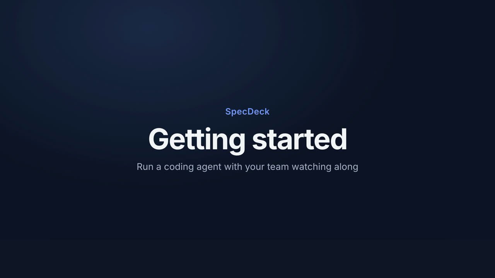
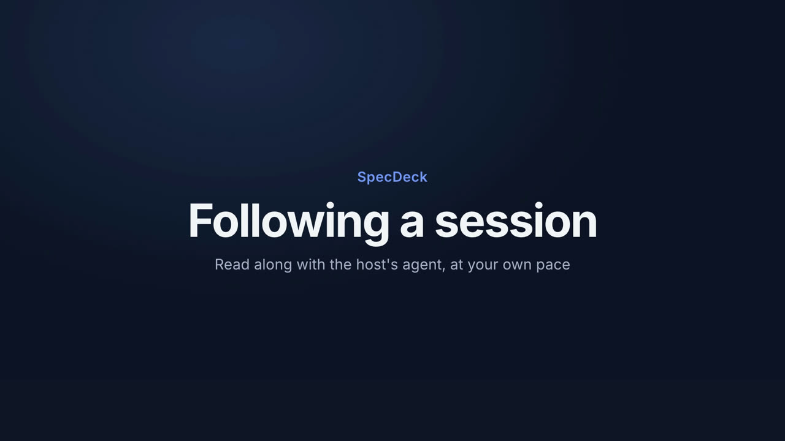
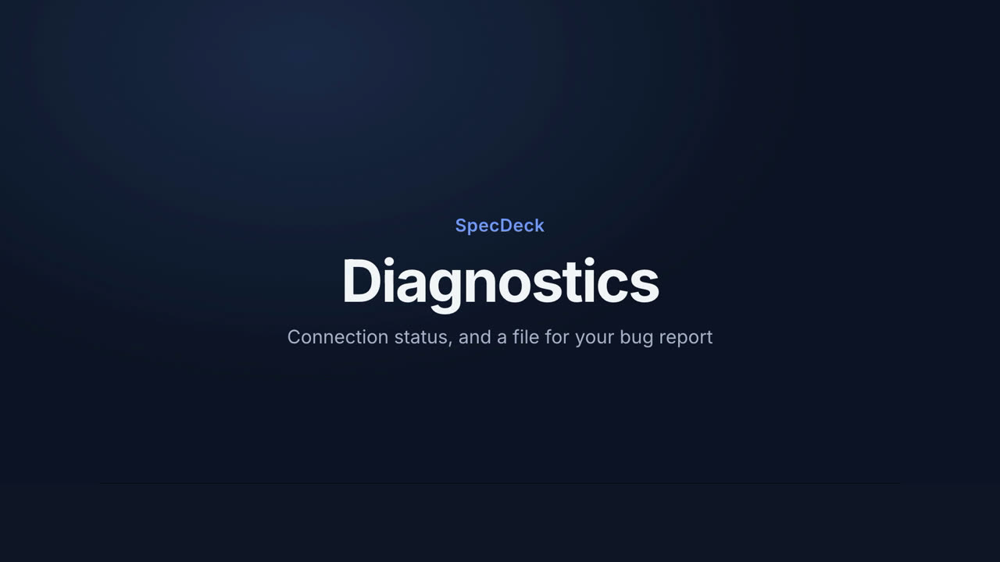
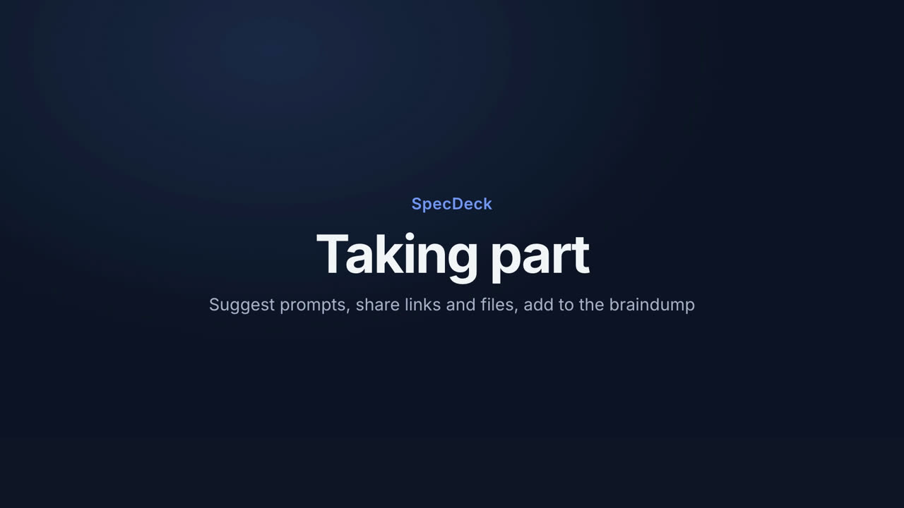
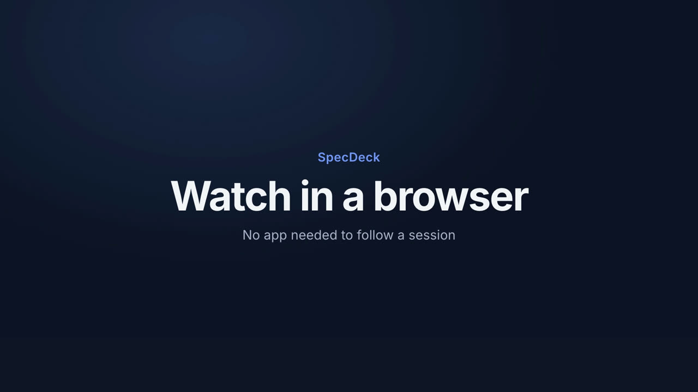
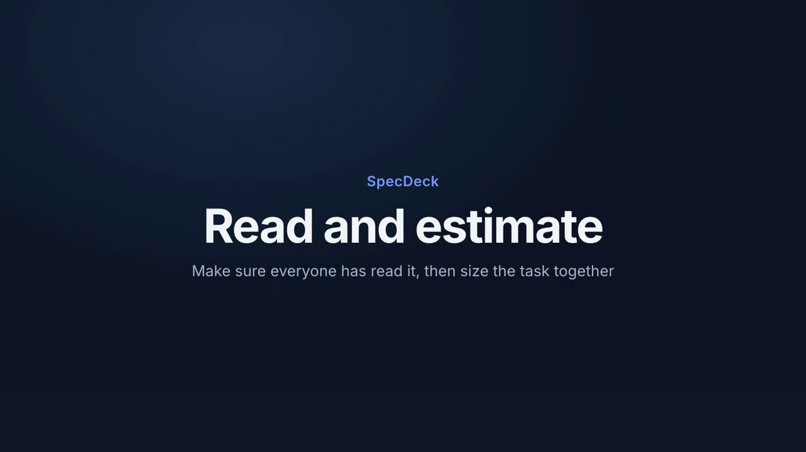
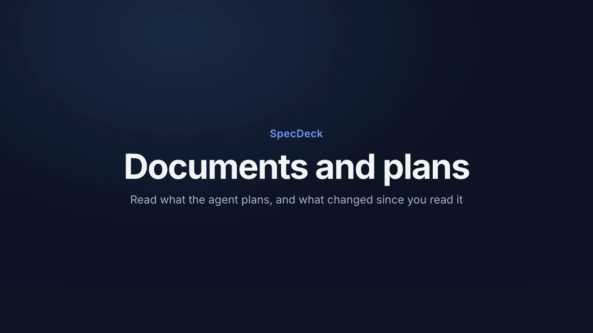
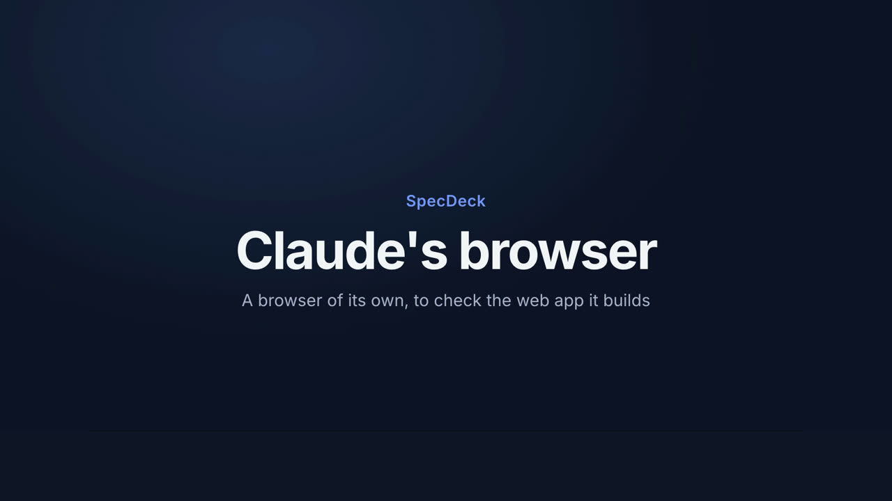
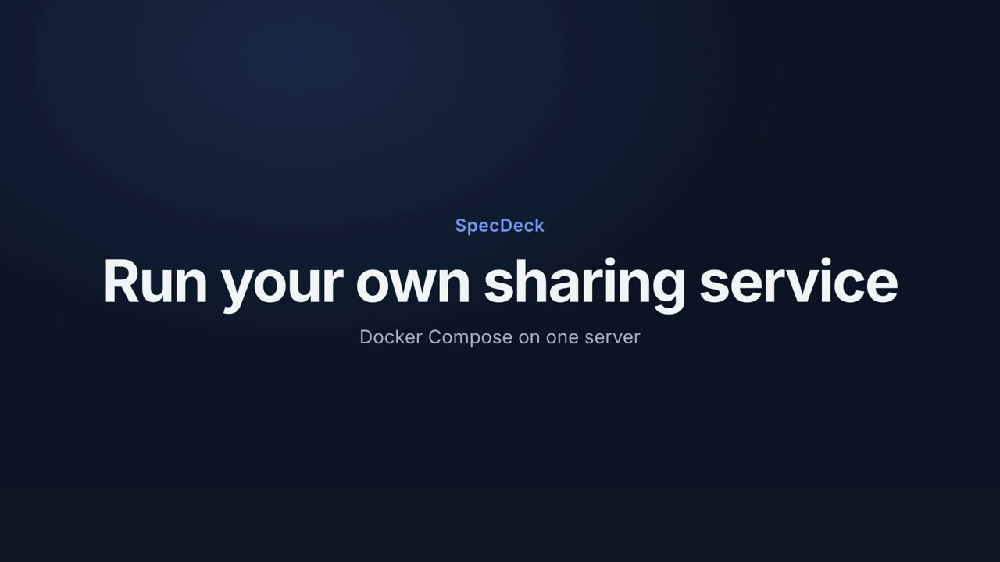
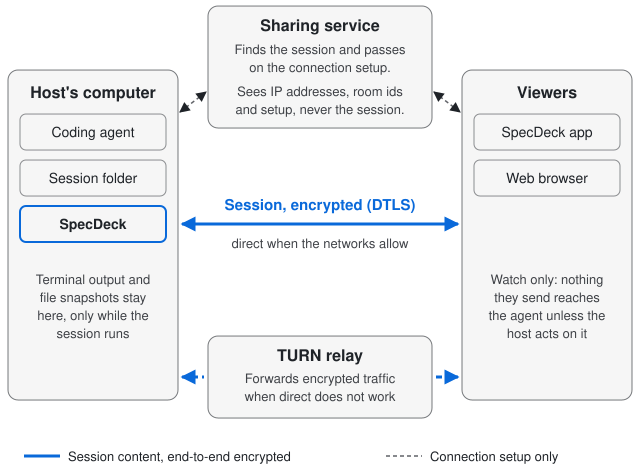

# SpecDeck

[](https://github.com/nickhartjes/specdeck/actions/workflows/ci.yml)
[](https://github.com/nickhartjes/specdeck/releases)
[](LICENSE)

SpecDeck lets one person (the **host**) run a coding agent on their computer while teammates (the **viewers**) follow along from anywhere. Viewers join with an invite code and can take part, but only the host types into the agent, on the host's own login, and nothing a viewer sends reaches the agent unless the host passes it on.

- **Host** Claude Code, OpenCode, omp, Codex, Grok, pi or a plain terminal, and see whether the agent is [working or waiting](https://nickhartjes.github.io/specdeck/guide/host/#while-you-host). [Hosting](https://nickhartjes.github.io/specdeck/guide/host/)
- **Invite** with a code or a link. Viewers who [join late](https://nickhartjes.github.io/specdeck/guide/follow/#joining-late) get the whole session, and a dropped connection catches up on its own. [Joining](https://nickhartjes.github.io/specdeck/guide/join/)
- **Follow** the terminal and, for Claude Code, a timeline of prompts, answers, tool calls and file diffs, each at their own pace, with search and the [Overview, Developer and Present layouts](https://nickhartjes.github.io/specdeck/guide/follow/#choose-a-layout). [Following](https://nickhartjes.github.io/specdeck/guide/follow/)
- **Read** the plans and documents the agent writes, formatted, with what changed since you last read them. [Documents and plans](https://nickhartjes.github.io/specdeck/guide/documents/)
- **Take part**: [suggest prompts](https://nickhartjes.github.io/specdeck/guide/follow/#suggest-a-prompt), [share files](https://nickhartjes.github.io/specdeck/guide/host/#share-files) and [links](https://nickhartjes.github.io/specdeck/guide/host/#share-a-link), and add notes to a [braindump](https://nickhartjes.github.io/specdeck/guide/host/#the-braindump) for the agent.
- **Read together and estimate**: the host asks everyone to read something or to vote, and sees who has answered. [Ask to read and estimate](https://nickhartjes.github.io/specdeck/guide/read-and-estimate/)
- **Get called back** when a plan is ready, a document changed or the agent finished, by [notifications](https://nickhartjes.github.io/specdeck/guide/settings/#notifications) you choose.
- **Claude's browser**: on macOS, Claude Code gets a browser of its own to check the app it is building. [Claude's browser](https://nickhartjes.github.io/specdeck/guide/browser/)
- **Claude in a sandbox**: host Claude Code that a script starts in a Docker Sandbox or a container, with the timeline still working. [Claude in a sandbox](https://nickhartjes.github.io/specdeck/guide/sandbox/)
- **Watch in a browser**, without installing the app, through the [web viewer](https://nickhartjes.github.io/specdeck/guide/join/#watch-in-a-browser).
- **A native app** for macOS, Windows and Linux, with menus, a tray icon while you host, [several windows](https://nickhartjes.github.io/specdeck/guide/host/#several-sessions-at-once), your [appearance](https://nickhartjes.github.io/specdeck/guide/settings/#the-window), [keyboard and screen readers](https://nickhartjes.github.io/specdeck/guide/keyboard/), and it [updates itself](https://nickhartjes.github.io/specdeck/install/#update).
- **Run your own sharing service** with Docker Compose or Kubernetes. [Run your own server](https://nickhartjes.github.io/specdeck/self-host/overview/)

SpecDeck is a native app built on Tauri 2 with a Rust session engine.

Documentation, for using the app and for running your own sharing service: **[nickhartjes.github.io/specdeck](https://nickhartjes.github.io/specdeck/)** (source in [`docs/site`](docs/site)). What the app does is specified in [`openspec/specs`](openspec/specs); the design decisions are in the [archived changes](openspec/changes/archive), starting with [`native-shared-session-mvp`](openspec/changes/archive/2026-10-31-native-shared-session-mvp/design.md), and the checks still to do on real machines are in [`openspec/changes/release-and-verification`](openspec/changes/release-and-verification).

## Videos

Short narrated walkthroughs, with captions; select one to watch it in the documentation.

| [](https://nickhartjes.github.io/specdeck/guide/first-steps/) | [](https://nickhartjes.github.io/specdeck/guide/follow/) | [](https://nickhartjes.github.io/specdeck/guide/troubleshooting/#see-what-the-connection-is-doing) |
|---|---|---|
| **Getting started** (1 min): host a session, share the code, a teammate joins | **Following a session** (1½ min): Overview or Developer, steps, search and files | **Diagnostics** (1½ min): Connection Status and a file for bug reports |

| [](https://nickhartjes.github.io/specdeck/guide/follow/#suggest-a-prompt) | [](https://nickhartjes.github.io/specdeck/guide/join/#watch-in-a-browser) | [](https://nickhartjes.github.io/specdeck/guide/read-and-estimate/) |
|---|---|---|
| **Taking part** (1½ min): suggest prompts, send links, add to the braindump | **Watch in a browser** (1 min): no app needed to follow a session | **Read and estimate** (1 min): make sure everyone has read it, then vote on a task |

| [](https://nickhartjes.github.io/specdeck/guide/documents/) | [](https://nickhartjes.github.io/specdeck/guide/browser/) | [](https://nickhartjes.github.io/specdeck/self-host/docker-compose/) |
|---|---|---|
| **Documents and plans** (1 min): the plan card, document tabs, and what changed since you read it | **Claude's browser** (1 min): its steps and screenshots in the timeline, on macOS | **Run your own sharing service** (1 min): Docker Compose, from DNS to a running service |

## Security and privacy

The session goes straight from the host's computer to each viewer, encrypted. The sharing service only helps them find each other, and neither it nor the relay can read the session. Viewers see everything in the terminal. [Security and privacy](https://nickhartjes.github.io/specdeck/security/overview/) in the documentation says what SpecDeck does with your data, who runs the servers, and the [known limits](https://nickhartjes.github.io/specdeck/security/known-limits/); [SECURITY.md](SECURITY.md) says how to report a vulnerability.

<picture>
  <source media="(prefers-color-scheme: dark)" srcset="docs/diagrams/data-flow-dark.svg">
  
</picture>

## Install

| Platform | How |
|---|---|
| macOS 11 or later (Apple silicon, Intel) | `brew install --cask nickhartjes/tap/specdeck`, or the `.dmg` from [Releases](https://github.com/nickhartjes/specdeck/releases) |
| Windows | `SpecDeck-x64-setup.exe` from [Releases](https://github.com/nickhartjes/specdeck/releases) |
| Linux | `nix run github:nickhartjes/specdeck` (builds from source, x86_64 and aarch64), or the AppImage or `.deb` from [Releases](https://github.com/nickhartjes/specdeck/releases) |
| Debian, Ubuntu, or Windows through WSL 2 (from source) | `scripts/install-from-source.sh` in a clone of this repository ([details](https://nickhartjes.github.io/specdeck/install/#from-source-debian-ubuntu-and-wsl)) |

With Nix, add it to a system or home configuration through the flake's `packages.<system>.specdeck` or `overlays.default`. The Nix package uses the public sharing service, `wss://specdeck.hartj.es/signal`, like the release builds; override it with `specdeck.override { signallingUrl = "wss://…/signal"; }`, or set `SPECDECK_SIGNALLING_URL` when starting the app.

**Can't install?** Viewers can [watch in a browser](https://nickhartjes.github.io/specdeck/guide/join/#watch-in-a-browser) instead: the sharing service serves a web viewer at its own address (for the built-in service, `https://specdeck.hartj.es/`), and hosts' join links open there. Hosting needs the app.

**Something not working?** **Help › Connection Status** (⇧⌘D on macOS, Ctrl+Shift+D on Windows and Linux) shows what the connection is doing, and **Help › Export Diagnostics…** saves a file to attach to a bug report. The file holds connection events and timings, never terminal output, names or addresses. See [Troubleshooting](https://nickhartjes.github.io/specdeck/guide/troubleshooting/).

Releases built before the signing certificates are in place are unsigned, so the system warns on first launch. On macOS, allow SpecDeck once under System Settings > Privacy & Security (Open Anyway), or run `xattr -dr com.apple.quarantine /Applications/SpecDeck.app`; the Homebrew cask says the same when it installs an unsigned release. On Windows, choose More info > Run anyway in the SmartScreen prompt.

## Repository layout

| Path | Contents |
|---|---|
| [`crates/protocol`](crates/protocol) | Wire protocol shared by hosts and viewers: messages, frames, signing, invite codes (no I/O) |
| [`crates/core`](crates/core) | Session engine: runs the agent in a pty, output log, timeline, WebRTC connections |
| [`crates/session`](crates/session) | A hosted session as a process of its own (`specdeck-session`), so it outlives the app: the agent's terminal, hooks, sharing and the viewers' connections |
| [`crates/local`](crates/local) | Local protocol between the app and its session processes |
| [`crates/diag`](crates/diag) | Diagnostic log, written by the app and by session processes; never records content |
| [`crates/server`](crates/server) | The sharing service (`specdeck-server`): matchmaking and TURN credentials; serves the web viewer when built with `web-viewer` |
| [`crates/web`](crates/web) | The viewer logic of `crates/protocol` as WebAssembly, for the web viewer |
| [`app/src-tauri`](app/src-tauri) | Tauri shell: windows, menus, tray, commands |
| [`app/ui`](app/ui) | Web UI (React, TypeScript, Vite), for the app and the web viewer (`web.html`, `src/web`) |
| [`openspec`](openspec) | Specs and change proposals |
| [`deploy/compose`](deploy/compose) | Docker Compose setup for the server, coturn and Caddy on one server |
| [`deploy/k8s`](deploy/k8s) | Kubernetes manifests for the server and coturn (`base`, `local`) ([README](deploy/k8s/README.md)) |
| [`docs/site`](docs/site) | Documentation site (Astro Starlight), published to GitHub Pages by [`docs.yml`](.github/workflows/docs.yml) |
| [`docs/video`](docs/video) | How-to videos, made from the UI's demo mode with HyperFrames and a local voice ([README](docs/video/README.md)) |
| [`docker`](docker) | Server image (`specdeck-server`, published to `ghcr.io/nickhartjes/specdeck-server`) |
| [`scripts`](scripts) | Helper scripts used by the `just` recipes and CI |

## Development

Tools are pinned in [`mise.toml`](mise.toml): Rust (with the `wasm32-unknown-unknown` target), Node, pnpm, just, cmake (needed to build libdatachannel) and the `wasm-bindgen` CLI. With [mise](https://mise.jdx.dev) installed, run `mise install`. On Linux, Tauri also needs the WebKitGTK development packages (see the CI workflow for the list), and libdatachannel's bindings need libclang (`libclang-dev`, already present on GitHub's runners). Builds from source use a local sharing service (`ws://127.0.0.1:18081/signal`) unless `SPECDECK_SIGNALLING_URL` is set when building.

```sh
just install   # install JavaScript dependencies
just dev       # start the desktop app in development mode
just check     # check formatting, lint, type-check and test (Rust and UI)
just capacity  # measure how 20 viewers affect the host's terminal (run alone)
just fmt       # format the Rust code
just package   # build installers for this platform (target/release/bundle)
just docs      # documentation site with live reload
just docs-build # build the documentation site and check its links
just video     # the how-to videos (docs/video/<name>/renders)
just check-web # web viewer: WebAssembly core and tests, the page (app/ui/dist-web), the service with it
```

To run the web viewer against a local service, run `just web-wasm` and `pnpm --dir app/ui build:web`, then `cargo run -p specdeck-server --features web-viewer` and open `http://127.0.0.1:8080/`.

Run `just` to list all recipes. To try sharing on your own machine (Colima with Kubernetes, `colima start --kubernetes`):

```sh
just local-dev     # the server and coturn on Colima's k3s, plus a host app and a viewer app
just local-up      # only deploy the server and coturn to Colima's k3s
just local-test    # check that two peers connect through the relay only
just local-down    # remove the deployment
```

`just local-dev` opens two windows, **SpecDeck (host)** and **SpecDeck (viewer)**, each with its own settings (`SPECDECK_PROFILE`, debug builds only). Host a session in one and join with its invite code in the other. To look at the UI without a session, run `pnpm --filter @specdeck/ui dev` and open `http://localhost:5173/?demo=start`, `?demo=host` or `?demo=viewer` in a browser.

See [`deploy/k8s/README.md`](deploy/k8s/README.md) for ports, secrets and the differences from a real cluster.

**A feature is not done until it is documented.** Every user-facing feature (for hosts, viewers, the web viewer or people who run the sharing service) gets a line in the overview above with a link to its documentation page, and a page or section in [`docs/site`](docs/site) that says what it does, who can use it and how, with shortcuts and settings. Features worth showing in motion also get a [video](docs/video), embedded on that page and listed under [Videos](#videos); otherwise the pull request says why none is needed. The [pull request template](.github/pull_request_template.md) asks for each of these, and the rules in [`openspec/config.yaml`](openspec/config.yaml) make every OpenSpec change plan them in its proposal and tasks. `just docs-build` fails on a broken link or anchor in the site, on a page missing from the sidebar ([`docs/site/sidebar.mjs`](docs/site/sidebar.mjs)), and on a README link into the site that does not resolve.

## CI

[`ci.yml`](.github/workflows/ci.yml) runs `just check` and `just package` on macOS, Windows and Ubuntu, and fails when an installer is larger than 25 MB ([`scripts/check-installer-size.sh`](scripts/check-installer-size.sh)). In between it runs `just capacity` on its own and reports the result without failing on it: on Ubuntu runners the 20-viewer measurement still varies too much from run to run.
[`nix.yml`](.github/workflows/nix.yml) builds the Nix flake on every push to main, and on pull requests that change what the Nix build depends on (lockfiles, manifests, `nix/`). Rust caches are saved from main only; pull requests reuse them. The Nix build compiles its Rust dependencies in a derivation of their own (with [crane](https://github.com/ipetkov/crane)), which `nix.yml` keeps in the Actions cache, so only a change to `Cargo.lock`, `flake.lock` or `nix/` builds them again. The flake's inputs, nixpkgs and crane, are updated by hand with `nix flake update`.
[Renovate](renovate.json) keeps dependencies up to date, and on Monday mornings also refreshes the indirect ones in `Cargo.lock` and `pnpm-lock.yaml`. When it changes the npm dependencies, [`renovate-nix-hash.yml`](.github/workflows/renovate-nix-hash.yml) updates their hash in `nix/package.nix` on its branch. It pushes that commit with `RENOVATE_NIX_HASH_TOKEN`, a fine-grained personal access token for this repository with Contents read and write only, so CI and Nix run for it on the pull request; the token expires and has to be renewed. Without that secret the workflow starts CI and Nix by hand, and the pull request's own checks for the commit need approval.

## Releases

Push a tag that matches the version in `Cargo.toml` and `app/src-tauri/tauri.conf.json`, for example `v1.0.0`. [`release.yml`](.github/workflows/release.yml) builds the installers on each platform, uploads them to a GitHub release under stable names (`SpecDeck-arm64.dmg`, `SpecDeck-x64.dmg`, `SpecDeck-x64-setup.exe`, `SpecDeck-x86_64.AppImage`, `SpecDeck-amd64.deb`), publishes it, and has [`homebrew.yml`](.github/workflows/homebrew.yml) update the cask in `nickhartjes/homebrew-tap` ([`scripts/render-cask.sh`](scripts/render-cask.sh)). The Nix flake follows the repository, so it needs nothing per release. With the update signing key, a final release also carries the signed update files and a `latest.json`, which installed apps from 1.2.0 on check for updates (prereleases are never offered). The secrets for the sharing service URL, signing, update signing and the tap are listed at the top of `release.yml`. Without the signing secrets the installers are unsigned (ad-hoc on macOS) and the cask explains how to open the app; without the update signing key installed apps find no update; without the tap deploy key the cask is not updated.

## License

[MIT](LICENSE)
